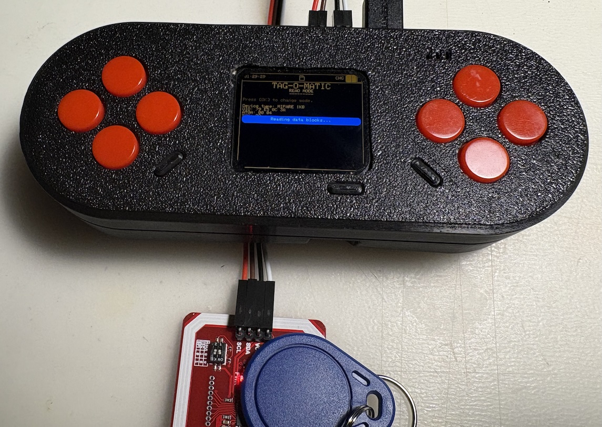

# RFID module for Lilka
RFID/NFC tag reader and writer based on a PN532 module. No soldering required.
The module comes with sets of pin headers and Dupont jumper wires for I2C or SPI connection

## Compatibility
Bruce

## Inventory <with pins>
- PN532 NFC RFID Module V3 Kit Reader

## Wiring
Use the 4-wire Dupont cable to connect the module to Lilka extension port directly:

| Lilka J2 # | Lilka pin | RFID        |
|------------|-----------|-------------|
| 8          | 14        |  SCL        |
| 9          | 13        |  SDA        |
| 10         | 12        |             |
| 11         | 3V3       |  VCC        |
| 12         | GND       |  GND        |

Note: The blank RFID card and tag coming with the module aren't suitable for cloning actual tags.
On the module board set switches for I2C mode

