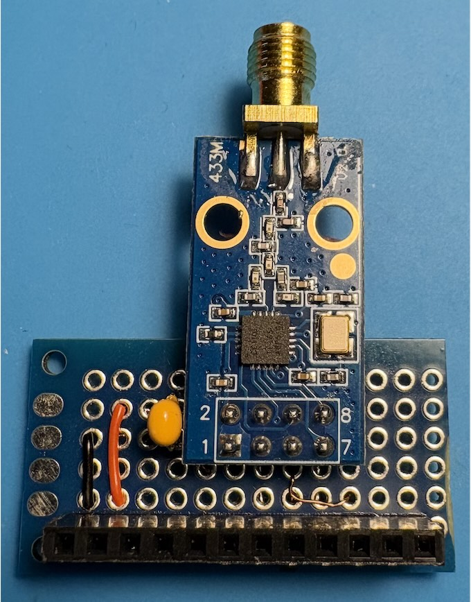

# C1101 RF-модуль для Лілки
Сканування, глушилка, спектрограмма, запис/відтворення сигналів до 1 Ггц. Модуляція: MSK, 2(G)FSK, 4(G)FSK, ASK та OOK 

## Сумісність
Усі функції групи RF в Bruce до 928 МГц. Перед використанням оберіть CC1101 в меню налаштувань.

## Необхідні компоненти
- CC1101 Transceiver module з розʼємом 2x4
- SMA-антена залежно від потреб, наприклад 433 Мгц
- Макетна плата розміром 20 × 80 мм (половинка)
- 12-контактний гніздовий роз'єм (мама, якщо у Ваша Лілка зібрана як у мене)
- тонкий мідний провід
- керамічний конденсатор 0,2-0,5 мкФ (необовʼязково)

## Підключення
| Lilka J2 # | Lilka pin | CC1101   |
|------------|-----------|----------|
| 1          | GND       | 1 GND    |
| 2          | 3V3       | 2 VCC    |
| 3          | RX (44)   |          |
| 4          | TX (43)   |          |
| 5          | 48        | 8 GD2    |
| 6          | 47        | 4 SS     |
| 7          | 21        | 3 GD0    |
| 8          | 14        | 6 MOSI   |
| 9          | 13        | 7 MISO   |
| 10         | 12        | 5 SCK    |
| 11         | 3V3       |          |
| 12         | GND       |          |

## Збирання
Гніздовий роз'єм і модуль LoRa потрібно вирівняти так, щоб забезпечити надійне з'єднання під час підключення до Lilka.
Через велику кількість дротів, що перетинаються, використовуйте обидві сторони макетної плати для їх прокладання.

